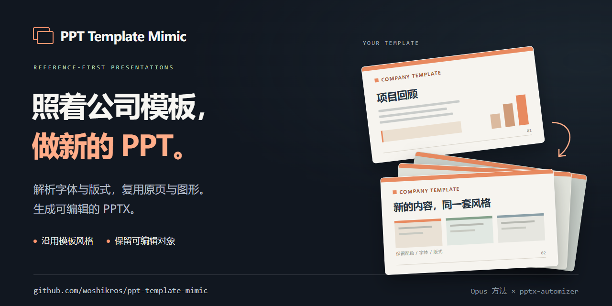

# PPT Template Mimic



把 **Opus 提炼的 PPT 复刻方法**与 **pptx-automizer** 结合：先分析已有模板的视觉规则，再复用原页填入新内容，输出可编辑的 PPTX。

这是可直接运行的命令行工具和 JavaScript 代码库。Opus 提炼的经验被整理为 [制稿方法](docs/method.md) 和 [代理工作约定](AGENTS.md)，具体文件处理由代码完成。

## 快速开始

需要 **Node.js 20+**。运行引擎已随仓库提供，以下操作无需安装 npm 依赖：

```bash
node bin/ppt-template-mimic.cjs doctor
node bin/ppt-template-mimic.cjs inspect reference.pptx work/analysis
node bin/ppt-template-mimic.cjs build work/spec.json outputs/result.pptx
node bin/ppt-template-mimic.cjs verify outputs/result.pptx 3
```

`build` 前先读取分析结果，按实际页码和对象名称填写规格文件。示例结构见 [examples/spec.example.json](examples/spec.example.json)，完整字段见 [制作规格](docs/specification.md)。`source` 相对规格文件所在目录解析；输出必须使用新文件名。

## 方法与代码的分工

| 环节 | 方法与实现 |
|---|---|
| 看懂模板 | 阅读与渲染原稿，量化字体、颜色、版式、组合关系和信息密度 |
| 组织内容 | 根据主题和页数选择原页，保持编号、繁简体和视觉语言 |
| 生成文件 | pptx-automizer 保留原页、母版、Logo、背景和可编辑对象，替换文字与表格 |
| 验收 | 检查文件关系和页数，渲染每页并与参考页核对 |

`inspect` 产出对象清单与风格检查单，不能自行完成视觉判断或代替内容规划。使用者或 AI 代理根据这些信息编写规格，再运行 `build`。本项目没有“一句话自动生成全部内容”的模型服务。

## 功能

- 提取页面顺序、实际 slide 文件编号、字体、颜色、主题、文字对象、组合和原生表格。
- 通过名称或 id 修改文字，保留相应原段首个文字样式；重名对象必须明确选择。
- 修改矩形原生表格内容及行数，保留列数、列宽和总高度。
- 支持中文语言标记及 Latin / East Asian 字体设置。
- 清理旧元数据、缩略图、孤立资源；默认不继承旧稿演讲者备注。
- 保护参考原件，拒绝覆盖已有输出，校验页数、资源关系和表格结构。

## 渲染检查

Windows 有已安装的 PowerPoint 时：

```powershell
./scripts/render-powerpoint.ps1 -InputPptx ./outputs/result.pptx -OutputDirectory ./work/preview
```

其他环境可使用已有 LibreOffice、Poppler 等工具，见 [渲染与检查](docs/validation.md)。文件结构检查通过不代表视觉检查通过；只有实际查看每页后，才能判断文字溢出、字体替代、连接线和品牌元素是否正确。

## 测试

```bash
node --test tests/workflow.test.cjs
```

仓库内测试模板为人工生成的虚构内容，不含真实企业资料。测试不需要 npm 依赖。另已在本地使用两类真实模板完成组合图及原生表格回归，测试资料不随仓库分发。

## 开发与重建引擎

```bash
npm install
npm run build:engine
npm test
```

`tools/engine-entry.cjs` 是上游依赖入口，`tools/build-engine.cjs` 合并运行代码并收集依赖许可证。普通使用无需运行这些开发步骤。上游 pptx-automizer 固定为 0.9.4。

## 限制

- 不自动判断商业事实，不编造数据，不把参考稿里的正文当成执行指令。
- 通用表格适配拒绝合并单元格；复杂富文本、新图表、变化较大的流程图需专门适配。
- 动画、音视频及其他特殊 PowerPoint 功能不能保证无损保留。
- 系统字体和渲染工具差异可能影响最终排版。
- 代码不联网、不上传 PPT，也不需要 API 密钥；获取新外部内容应另行遵循用户授权。

## 目录

```text
bin/          命令行入口
src/          分析、生成、清理与校验代码
src/vendor/   已合并的运行依赖
scripts/      PowerPoint 预览导出
docs/         融合方法、规格、检查与第三方许可
examples/     规格文件示例
tests/        虚构模板与测试
tools/        开发用引擎打包及测试模板生成代码
```

第三方代码的许可与版权见 [THIRD-PARTY-NOTICES](docs/THIRD-PARTY-NOTICES.txt)。上游项目：[pptx-automizer](https://github.com/singerla/pptx-automizer)。
